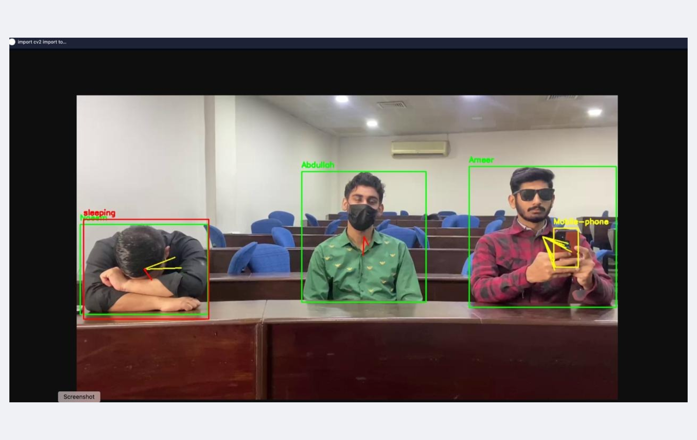
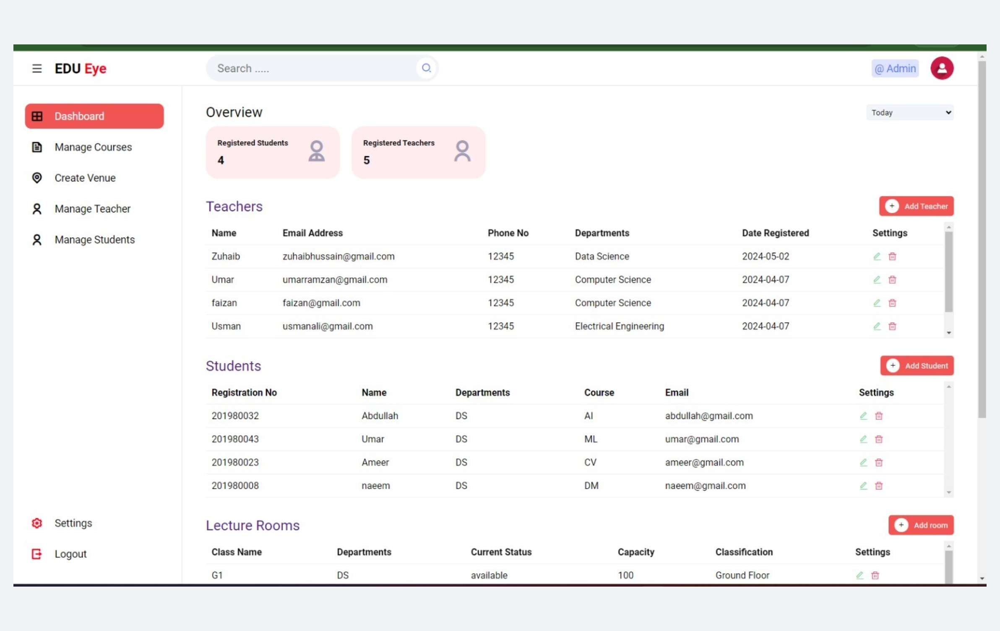
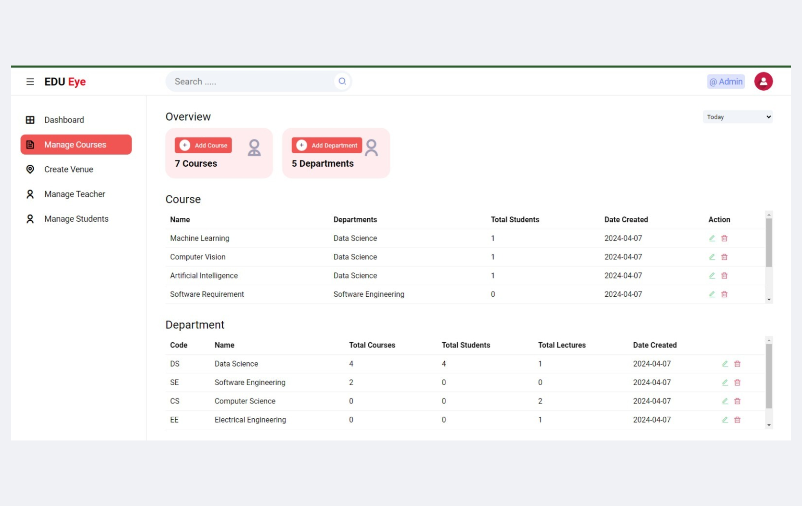
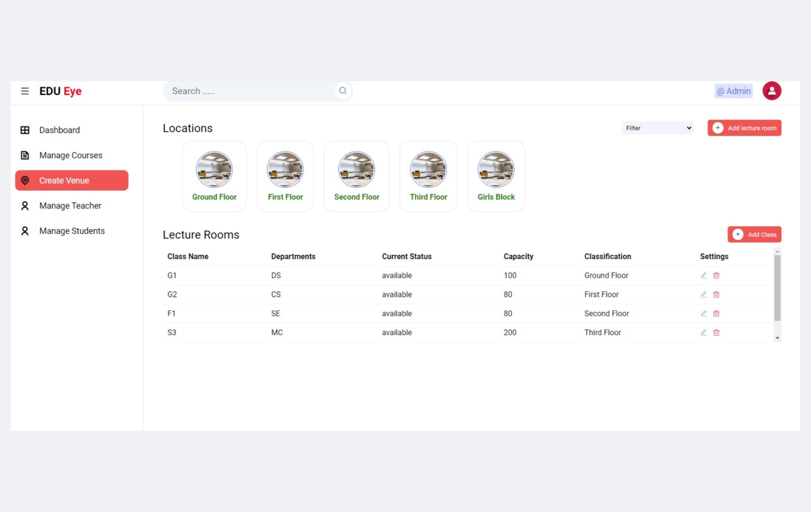
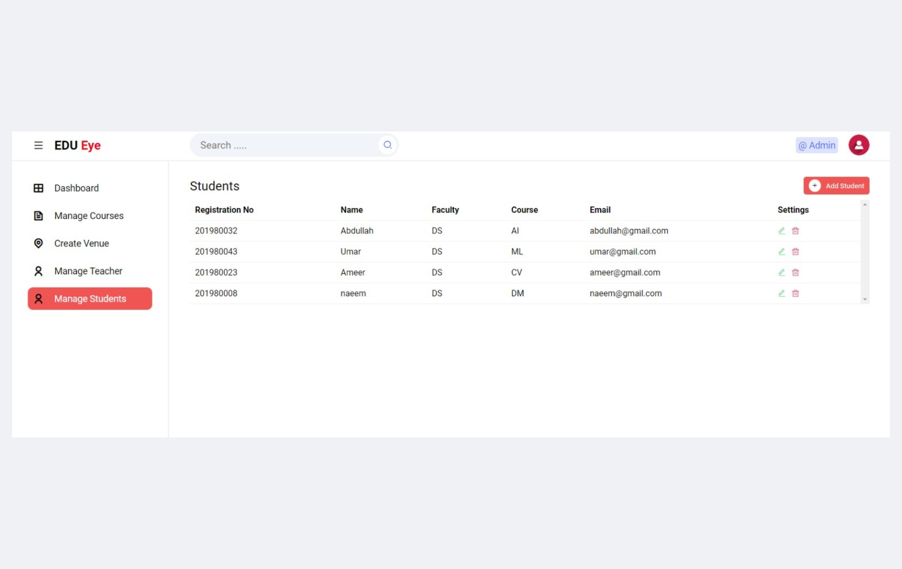
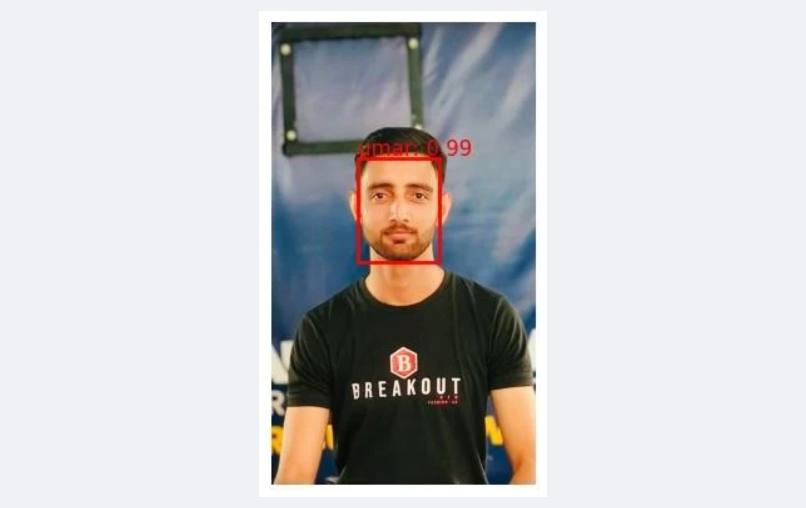
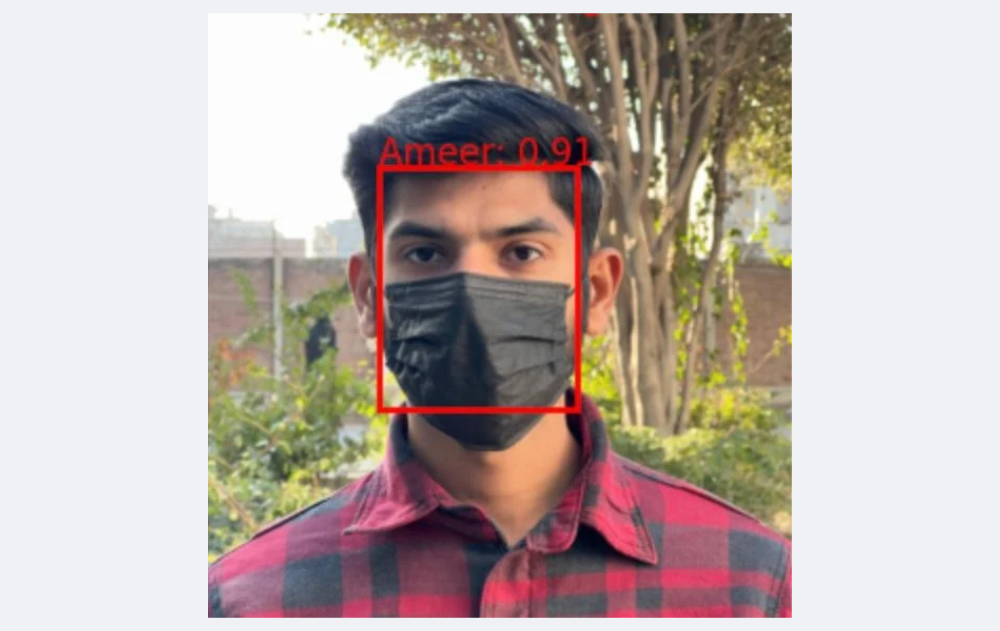
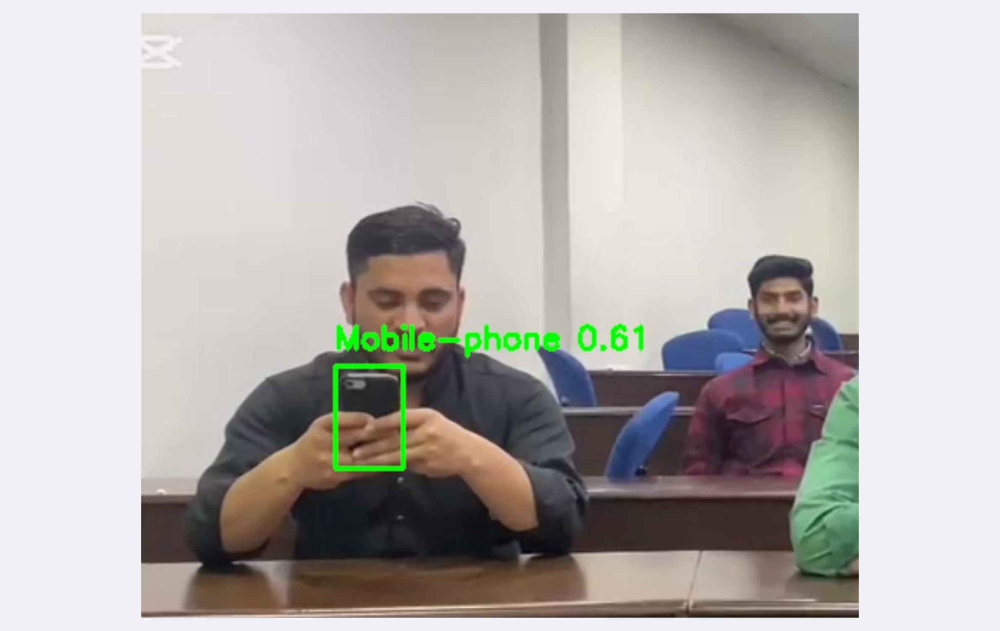
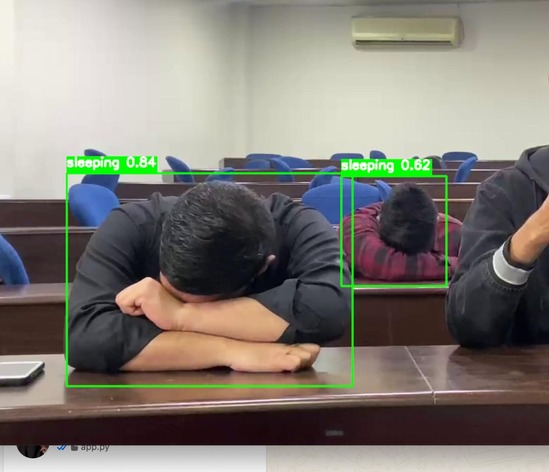

# EDU Eye: Class Surveillance System

A real-time classroom monitoring system. It marks attendance with face recognition and detects mobile phone use and sleeping students from a live camera feed. Deep learning models run behind a Flask API, and a PHP web app manages courses, teachers, students and lecture rooms.

This is my final year project (BS Data Science).



## Features

- **Automatic attendance:** identifies students by face, including partly covered faces (for example with a mask)
- **Mobile phone detection:** measures how long each student uses a phone
- **Sleep detection:** measures how long each student sleeps
- **Session report:** at the end of a session, the API returns attendance status, time present, phone time and sleeping time for every student
- **Web app:** admin dashboard to manage courses, departments, teachers, students and lecture rooms, plus lecturer and student portals

## How it works

```
Camera -> Flask API (app.py) -> for every frame:
   1. MTCNN detects faces
   2. The face recognition model identifies each face (identity is confirmed after 5 matching frames)
   3. YOLOv8n detects people (bodies)
   4. Custom YOLO models detect mobile phones and sleeping students
   5. SORT trackers follow faces, bodies, phones and sleeping students across frames
   6. Phone and sleep events are linked to the closest tracked person
-> End of session: JSON report per student
```

## Models

| Model | Purpose | Framework |
| --- | --- | --- |
| MTCNN (facenet-pytorch) | Face detection | PyTorch |
| Occlusion-aware IR-ResNet-50 (FROM-style, 465 classes) | Face recognition | PyTorch |
| YOLOv8n (COCO, person class) | Body detection | Ultralytics |
| Custom YOLO (`phone.pt`) | Mobile phone detection | Ultralytics |
| Custom YOLO (`sleep.pt`) | Sleep detection | Ultralytics |
| SORT | Multi-object tracking | NumPy / SciPy |

## Dataset

The face recognition model was trained on the AFDB face dataset (465 identities), to which photos of the project team members were added so the system could be tested live on them. The dataset is not included in this repository. The class names of the model are saved in `API_endpoints/classes.json`.

## Results

**Face recognition** (28 epochs, 465 identities, 80/20 train/validation split, see `notebooks/FROM_train.ipynb`):

| Metric | Train | Validation |
| --- | --- | --- |
| Accuracy | 93.7% | 83.3% |
| Loss | 0.255 | 0.809 |

**Detection models:** the app uses a confidence threshold of 0.60 for phones and 0.70 for sleeping students.

<!-- TODO (optional): add the mAP / precision / recall of phone.pt and sleep.pt from your YOLO training runs -->

## Screenshots

### Web app

| Admin dashboard | Manage courses |
| --- | --- |
|  |  |

| Lecture rooms | Manage students |
| --- | --- |
|  |  |

### Detection examples

| Face recognition | Face recognition with a mask |
| --- | --- |
|  |  |

| Mobile phone detection | Sleep detection |
| --- | --- |
|  |  |

## Project structure

```
Class-Surveillance-System/
├── API_endpoints/
│   ├── app.py                # Flask API that runs all models
│   ├── sort.py               # SORT tracker
│   └── classes.json          # Class names of the face model
├── Models/                   # Model weights (from_model_28.pth, phone.pt, sleep.pt, yolov8n.pt)
├── Web-App/
│   └── facerecognition/      # PHP web app (Admin, Lecture and Student portals) + attendancemsystem.sql
├── notebooks/
│   └── FROM_train.ipynb      # Training notebook of the face recognition model
├── docs/images/              # Screenshots used in this README
├── requirements.txt
└── README.md
```

## Setup

### 1. Clone the repository

The face recognition weights (192 MB) are stored with [Git LFS](https://git-lfs.com). Install it once **before** cloning, and use `git clone` (the "Download ZIP" button does not include this file).

```bash
# Install Git LFS once (for example: brew install git-lfs, or conda install -c conda-forge git-lfs)
git lfs install

# Download the project and open the folder
git clone https://github.com/Umar43/Class-Surveillance-System-.git
cd Class-Surveillance-System-
```

### 2. Install the Python packages

Python 3.12 was used for development.

```bash
# Create and activate a virtual environment
python -m venv .venv
source .venv/bin/activate

# Install the required packages
pip install -r requirements.txt
```

### 3. Start the Flask API

```bash
# Start the API on port 5000 (uses the built-in webcam by default)
python API_endpoints/app.py

# Use another camera number or a video file instead
CAMERA_SOURCE=1 python API_endpoints/app.py
CAMERA_SOURCE=/path/to/video.mp4 python API_endpoints/app.py
```

| Endpoint | Method | What it does |
| --- | --- | --- |
| `/start` | POST | Starts a monitoring session |
| `/video_feed` | GET | Streams the annotated camera video (MJPEG) |
| `/end` | POST | Ends the session and returns the report |

Quick test (the API must be running):

```bash
# Start a session, then open http://127.0.0.1:5000/video_feed in the browser
curl -X POST http://127.0.0.1:5000/start

# End the session and get the attendance report
curl -X POST http://127.0.0.1:5000/end
```

Example response of `/end`:

```json
{
  "students": [
    {
      "studentRegistrationNumber": "000000001",
      "name": "Student A",
      "attendanceStatus": "Present",
      "availabilityTime": "42min 10sec",
      "mobileUsage": "3min 5sec",
      "sleepingTime": "0min 0sec"
    }
  ]
}
```

### 4. Run the web app

The web app needs PHP and a MySQL/MariaDB database. The database dump was exported from XAMPP (MariaDB 10.4, PHP 8.2), so XAMPP is the easiest way to run it.

1. Start **Apache** and **MySQL** in XAMPP.
2. Create a database named `attendancemsystem` and import the dump into it. In phpMyAdmin: **New**, name `attendancemsystem`, then **Import** the file `Web-App/facerecognition/attendancemsystem.sql`. Or use the terminal:

```bash
# Create the empty database
mysql -u root -p -e "CREATE DATABASE attendancemsystem"

# Import the tables and the demo data into it
mysql -u root -p attendancemsystem < Web-App/facerecognition/attendancemsystem.sql
```

3. Check the database settings in `Web-App/facerecognition/Includes/dbcon.php` (host, user, password and the database name `attendancemsystem`). The XAMPP default is user `root` with an empty password.
4. Copy the folder `Web-App/facerecognition/` into XAMPP's `htdocs` folder and open `http://localhost/facerecognition/` in the browser.

**Demo logins** (demo data only):

| Role | Email | Password |
| --- | --- | --- |
| Admin | admin@gmail.com | admin |
| Lecturer | umar@gmail.com | umar |
| Student | umar@gmail.com | 1234 |

<!-- TODO: check on the student login page whether it uses the email or the registration number (201980043) -->

## Limitations

- Face recognition accuracy is measured on a random 20% split of the same dataset, not on separate classroom recordings.
- The system recognizes only the students registered in the model (a fixed list of names).
- The API runs on the CPU unless a CUDA GPU is available, so the video can be slow on a laptop.
- The web app is a demo: passwords in the demo database are stored in plain text.

## Tech stack

Python, PyTorch, facenet-pytorch, Ultralytics YOLOv8, SORT, OpenCV, Flask, PHP, MySQL/MariaDB, JavaScript

## Acknowledgements

- [SORT](https://github.com/abewley/sort) multi-object tracker by Alex Bewley
- [Ultralytics YOLOv8](https://github.com/ultralytics/ultralytics)
- [facenet-pytorch](https://github.com/timesler/facenet-pytorch) (MTCNN)

## Author

**Muhammad Umar** - [LinkedIn](https://linkedin.com/in/umar43) | [GitHub](https://github.com/Umar43)
